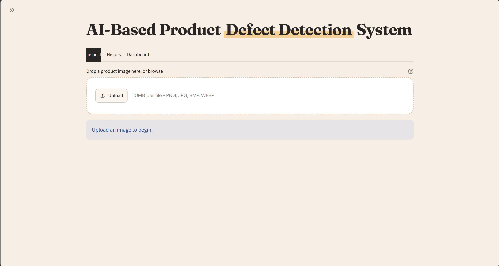
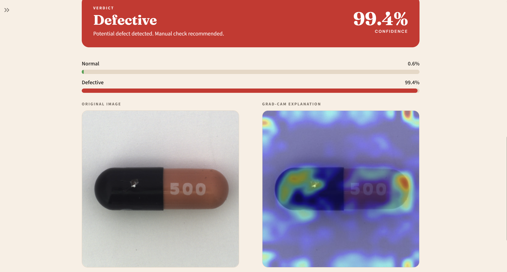
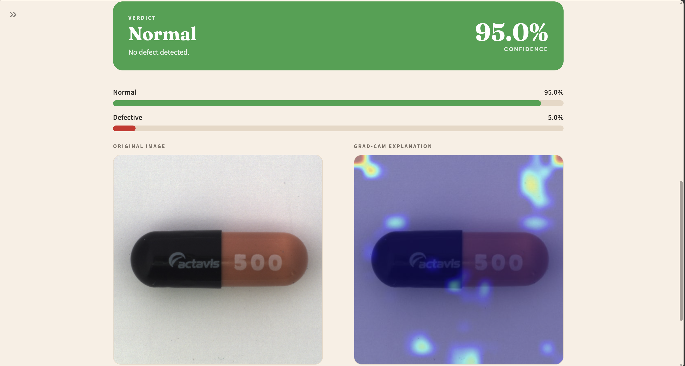

# AI-Based Product Defect Detection System

Upload a photograph of a product and get an instant verdict, **Normal** or **Defective**, with a confidence score and a **Grad-CAM heat-map** showing which part of the image influenced the decision.



## Features

- **ResNet50 transfer learning** (PyTorch), fine-tuned on the capsule category of the MVTec AD dataset
- **Confidence score and class probabilities** for every prediction
- **Grad-CAM explanation** that highlights the regions behind the decision
- **FastAPI REST backend** with automatic interactive docs at `/docs`
- **Persistent database** (SQLAlchemy): SQLite locally, PostgreSQL when deployed, so inspection history is never lost
- **Streamlit frontend** built from small component files, with Inspect, History and Dashboard tabs

## Results

Evaluated on **53 unseen test images** (36 normal, 17 defective) from a stratified 70 / 15 / 15 split.

| Metric (defective = positive class) | Baseline (224 px, 10 epochs) | Final (320 px, 12 epochs) |
| ----------------------------------- | ---------------------------- | ------------------------- |
| Accuracy                            | 0.8868                       | **0.9434**                |
| Precision                           | 0.9231                       | **1.0000**                |
| Recall                              | 0.7059                       | **0.8235**                |
| F1-score                            | 0.8000                       | **0.9032**                |

Final model: 14 of 17 defects found, 3 missed, 0 false alarms, all 36 normal images correct.

> **Note:** the test set is small, and the improvement from 88.7 % to 94.3 % is about three more correct images, so treat it as encouraging, not proven. Input size and epochs were changed together. Grad-CAM maps are coarse: they show the neighbourhood that mattered, not an exact defect outline.

Confusion matrix and metrics files are in `backend/saved_models/` (`confusion_matrix.png`, `test_metrics.json`).

| Defective result                        | Normal result                     |
| --------------------------------------- | --------------------------------- |
|  |  |

## Tech stack

| Layer    | Tools                                                         |
| -------- | ------------------------------------------------------------- |
| Model    | Python, PyTorch, Torchvision (ResNet50), OpenCV, scikit-learn |
| Backend  | FastAPI, Uvicorn, SQLAlchemy                                  |
| Database | SQLite (local), PostgreSQL (deployment)                       |
| Frontend | Streamlit                                                     |

## Project structure

```
ai-defect-detection/
├── backend/
│   ├── app/
│   │   ├── main.py            # FastAPI app and startup
│   │   ├── config.py          # settings (.env)
│   │   ├── database.py        # database connection
│   │   ├── models.py          # database tables
│   │   ├── schemas.py         # API response shapes
│   │   ├── routers/           # predict.py, history.py
│   │   └── ml/                # model, preprocess, gradcam, predictor
│   ├── ml_training/           # prepare_dataset.py, train.py, evaluate.py
│   └── saved_models/          # trained model goes here (not in git)
├── frontend/
│   ├── app.py                 # Streamlit main page
│   ├── components/            # header, sidebar, upload_panel, result_card, history_table, stats_panel
│   ├── services/api_client.py # all calls to the backend
│   └── styles.py              # colours and look
├── data/                      # dataset goes here (not in git)
├── docs/                      # screenshots
└── requirements.txt
```

## Getting started

Requires **Python 3.10 to 3.12** and Git. Commands below are for Windows PowerShell; on Mac/Linux activate with `source venv/bin/activate`.

### 1. Clone and install

```bash
git clone https://github.com/Tridha-05/product_defect_detection.git
cd YOUR-REPO
python -m venv venv
venv\Scripts\activate
pip install -r requirements.txt
```

### 2. Get the trained model

Download `resnet50_defect.pth` from the [Releases page](https://github.com/YOUR-USERNAME/YOUR-REPO/releases) and place it in `backend/saved_models/`.

_Or train it yourself, see "Training" below._

### 3. Run (two terminals, venv active in both)

**Backend**

```bash
cd backend
uvicorn app.main:app --reload
```

API docs: http://127.0.0.1:8000/docs

**Frontend**

```bash
cd frontend
streamlit run app.py
```

App: http://localhost:8501

The database file is created automatically on first start. No setup is needed.

## Training (optional)

### Dataset

The dataset is not stored in this repository. Download the **capsule** category of MVTec AD from the [official page](https://www.mvtec.com/company/research/datasets/mvtec-ad/downloads) and extract it so this path exists:

```
data/mvtec_ad/capsule/train/good/
```

If the official link does not work, the capsule category is also mirrored on Hugging Face (`alexsu52/mvtec_capsule`, file `capsule.tar.xz`).

### Commands

```bash
cd backend
python ml_training/prepare_dataset.py --categories capsule
python ml_training/train.py --epochs 12
python ml_training/evaluate.py
```

- `prepare_dataset.py` labels images as normal or defective and splits them 70 / 15 / 15 (stratified, seed 42).
- `train.py` fine-tunes only `layer4` and a new classifier, with class-weighted loss, and keeps the best checkpoint by validation macro-F1.
- `evaluate.py` reports accuracy, precision, recall, F1 and a confusion matrix on the unseen test set.
- The input size is set in `backend/app/ml/preprocess.py` (`IMAGE_SIZE`).

## API endpoints

| Method | URL                                         | Purpose                                                                                          |
| ------ | ------------------------------------------- | ------------------------------------------------------------------------------------------------ |
| GET    | `/api/health`                               | Status of backend, model and database                                                            |
| POST   | `/api/predict`                              | Upload an image, get label, confidence, probabilities and Grad-CAM image (saved to the database) |
| GET    | `/api/history`                              | List past inspections                                                                            |
| GET    | `/api/history/{id}/original` and `/heatmap` | Stored images                                                                                    |
| DELETE | `/api/history/{id}`                         | Delete a record                                                                                  |
| GET    | `/api/stats`                                | Totals, defect rate, average confidence                                                          |

## Database and deployment

The database address comes from the `DATABASE_URL` setting (see `backend/.env.example`). Locally it uses a SQLite file. For deployment, set `DATABASE_URL` to a hosted PostgreSQL database (for example Neon or Supabase) and the history will survive restarts, with no code changes. For deployed servers, set `MODEL_URL` to the Release download link and the backend downloads the model on first start. The frontend reads the backend address from `API_URL`.

## Limitations

- One product category (capsules) and a small 53-image test set, so results carry real uncertainty
- Binary decision only; the defect type is not identified
- Some defects are still missed (recall 82.4 %)
- Grad-CAM is a coarse indication, not a pixel-accurate defect mask

## Future scope

- Test on more MVTec AD categories
- Improve recall by threshold tuning, more defect images and cross-validation
- Finer localisation (Grad-CAM++, segmentation using the MVTec masks)
- Defect-type classification and a hybrid with unsupervised anomaly detection
- Camera integration, cloud deployment and user authentication

## Dataset licence and citation

MVTec AD is released under **CC BY-NC-SA 4.0** (non-commercial use only). Please cite:

> P. Bergmann, M. Fauser, D. Sattlegger, C. Steger, "MVTec AD: A Comprehensive Real-World Dataset for Unsupervised Anomaly Detection", IEEE/CVF CVPR, 2019.

This project was built for academic purposes.
